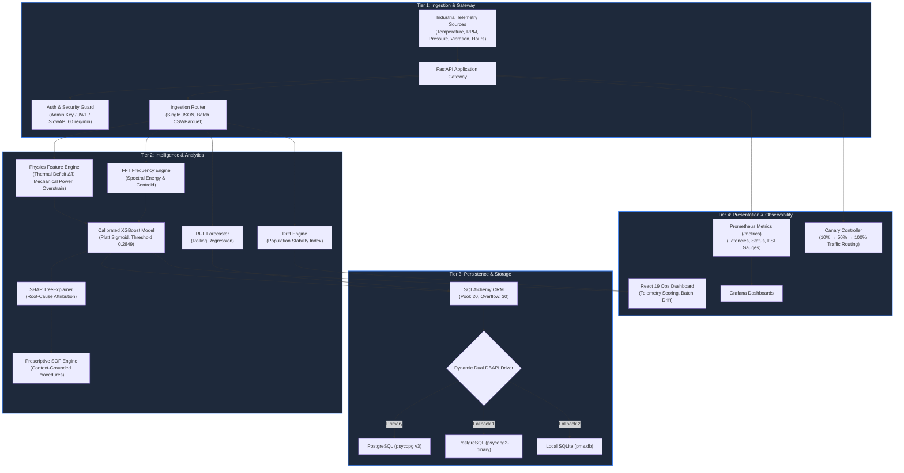

# Predictive Maintenance System (PMS)

[](https://github.com/Susil-commits/Predictive-Maintenance-System/actions/workflows/ci.yml)
[](backend/tests/)
[](https://fastapi.tiangolo.com)
[](https://react.dev)
[](https://xgboost.readthedocs.io)
[](https://opensource.org/licenses/MIT)

> **Live Production Deployments:**
> - 🌐 **Operations Dashboard**: [https://pms-frontend.vercel.app](https://pms-frontend.vercel.app)
> - ⚡ **API Gateway**: [https://pms-backend.onrender.com](https://pms-backend.onrender.com) | 📖 **OpenAPI Docs**: [/docs](https://pms-backend.onrender.com/docs) | 📊 **Metrics**: [/metrics](https://pms-backend.onrender.com/metrics)

The Predictive Maintenance System (PMS) is an end-to-end machine learning platform and edge-ready API designed for real-time condition monitoring and equipment failure risk assessment across industrial powertrains. It ingests multi-channel sensor telemetry, extracts physics-informed indicators, delivers statistically calibrated probabilities via Platt sigmoid scaling (`CalibratedClassifierCV`), and generates explainable root-cause diagnostics using SHAP TreeExplainer. The platform includes continuous population drift monitoring (PSI), remaining useful life (RUL) forecasting, dual-driver database resilience (`psycopg` v3 / `psycopg2`), and a responsive React 19 operational dashboard.

> [!NOTE]
> **Dataset & Scope Disclosure:** Trained and evaluated on the UCI AI4I 2020 synthetic milling benchmark (10,000 records). Reported metrics validate end-to-end data pipelines, calibration dynamics, and architecture, but **do not represent field reliability on physical machinery**.

---

## 🏗️ System Architecture



---

## 📊 Honest Evaluation & Model Results

Performance pulled directly from serialized model evaluation in [`ml/model_info.json`](ml/model_info.json) and validated across held-out testing (N = 2,000; 68 failure positives) with **1,000-sample bootstrap 95% confidence intervals** and **Stratified 5-Fold Cross-Validation**:

### 1. Held-Out Test Set Benchmark (N = 2,000, 28:1 Class Imbalance)

| Model Architecture | Decision Threshold | ROC-AUC (95% Bootstrap CI) | F1-Score (95% Bootstrap CI) | Precision | Recall | Brier Score Loss |
| :--- | :---: | :---: | :---: | :---: | :---: | :---: |
| **Logistic Regression** (Baseline) | 0.5000 | 0.9065 | 0.2500 | 0.1476 | 0.7794 | 0.1171 |
| **Random Forest** (150 Trees) | 0.5000 | 0.9313 | 0.3766 | 0.3372 | 0.4265 | 0.0488 |
| **LightGBM** (Scale-Weighted) | 0.5000 | 0.9276 | 0.4260 | 0.3564 | 0.5294 | 0.0363 |
| **XGBoost** (Uncalibrated Default) | 0.5000 | 0.9303 | 0.0000 | 0.0000 | 0.0000 | 0.0887 |
| **Calibrated XGBoost (Production)** | **0.2849** | **0.9336** `[0.9070, 0.9551]` | **0.4277** `[0.3239, 0.5091]` | **0.3736** | **0.5000** | **0.0263** `[0.0215, 0.0313]` |

* **Calibration Impact**: 3-fold Platt sigmoid scaling reduces Brier score error by **70.38%** (0.0887 → 0.0263). See the reliability diagram at [`ml/calibration_reliability_diagram.png`](ml/calibration_reliability_diagram.png).
* **Threshold Tuning**: Shifting cutoff from 0.50 to 0.2849 overcomes 28:1 imbalance, lifting F1 from 0.00 to 0.4277 (capturing 50% of emerging failures).

### 2. Failure-Mode Uncertainty Profile (Stratified 5-Fold Cross-Validation)

| Failure Mode | Total Support | Mean Supp / Fold | CV F1 (Mean ± Std) | CV Recall (Mean ± Std) | CV ROC-AUC (Mean ± Std) | Empirical Diagnostic Status |
| :--- | :---: | :---: | :---: | :---: | :---: | :--- |
| **Overstrain (OSF)** | 92 | 18.4 | **0.4137 ± 0.0984** | 0.5014 ± 0.1617 | 0.9715 ± 0.0136 | **Strong Signature**: High mechanical separability from torque × speed. |
| **Power Failure (PWF)** | 80 | 16.0 | **0.2956 ± 0.0671** | 0.3522 ± 0.1093 | 0.9394 ± 0.0119 | **Sensitive**: Triggered by mechanical power breaching motor limits. |
| **Thermal (HDF)** | 115 | 23.0 | **0.1212 ± 0.0384** | 0.1113 ± 0.0389 | 0.9330 ± 0.0032 | **Known Limit**: Detects acute shocks, misses gradual thermal creep. |
| **Tool Wear (TWF)** | 43 | 8.6 | **0.0285 ± 0.0353** | 0.0500 ± 0.0667 | 0.9144 ± 0.0124 | **Data-Starved**: F1 collapses to 0.0 in 3/5 folds. Requires wear sensor heads. |
| **All Failures (Overall)** | 339 | 67.8 | **0.3466 ± 0.0212** | 0.2597 ± 0.0252 | 0.9348 ± 0.0087 | Aggregate CV baseline across 28:1 imbalanced distribution. |

---

## ⚡ Quickstart

### Option 1: Full-Stack Docker Compose (Recommended)

Start the API gateway, React UI, PostgreSQL database, Prometheus collector, and Grafana with one command:

```bash
docker-compose up --build -d
```

| Service | Access URL | Default Credentials / Purpose |
| :--- | :--- | :--- |
| **React Dashboard** | `http://localhost:3000` | Operational web interface |
| **FastAPI Backend** | `http://localhost:8000` | Interactive OpenAPI documentation at `/docs` |
| **Prometheus** | `http://localhost:9090` | Telemetry & PSI scraping engine |
| **Grafana** | `http://localhost:3001` | Pre-configured operational monitoring |
| **PostgreSQL** | `localhost:5432` | User: `postgres`, Password: `password` |

To tear down: `docker-compose down -v`

### Option 2: Local Python & Node.js Development

```bash
# 1. Backend Setup
python -m venv .venv && source .venv/bin/activate    # Windows: .venv\Scripts\activate
pip install -r backend/requirements.txt
cp .env.example .env
python ml/train.py                                   # Generate serialized model artifacts
uvicorn backend.main:app --host 127.0.0.1 --port 8000 --reload

# 2. Frontend Setup (separate terminal)
cd frontend && npm install && npm run dev
```

Run test suite: `pytest backend/tests/ -v --cov=backend --cov-report=term-missing`

---

## 📖 Deep Documentation & References

- 🏛️ **[System Architecture Reference](docs/ARCHITECTURE.md)**: Four-tier deep dive, physics formulas, FFT spectral extraction, DB pooling, and canary mechanics.
- 💼 **[Business Case & Industrial ROI](docs/BUSINESS_CASE.md)**: Worked economic example on downtime reduction, cost-sensitive optimization matrix, and unit economics.
- 📋 **[Scientific Model Card](ml/MODEL_CARD.md)**: Explicit intended and out-of-scope uses, calibration reliability curves, slice verification, and known weaknesses.
- 🚀 **[Load Testing & Concurrency Benchmark](docs/LOAD_TEST_RESULTS.md)**: Locust benchmark results at 10, 50, and 100 users, connection pooling mechanics, and latency breakdown.

---

## 📜 License & Citation

Licensed under the **MIT License** — see [LICENSE](LICENSE).

```bibtex
@misc{pms2026,
  author = {Susil Nayak},
  title = {Predictive Maintenance System (PMS): Calibrated Industrial Intelligence Platform},
  year = {2026},
  url = {https://github.com/Susil-commits/Predictive-Maintenance-System}
}
```
