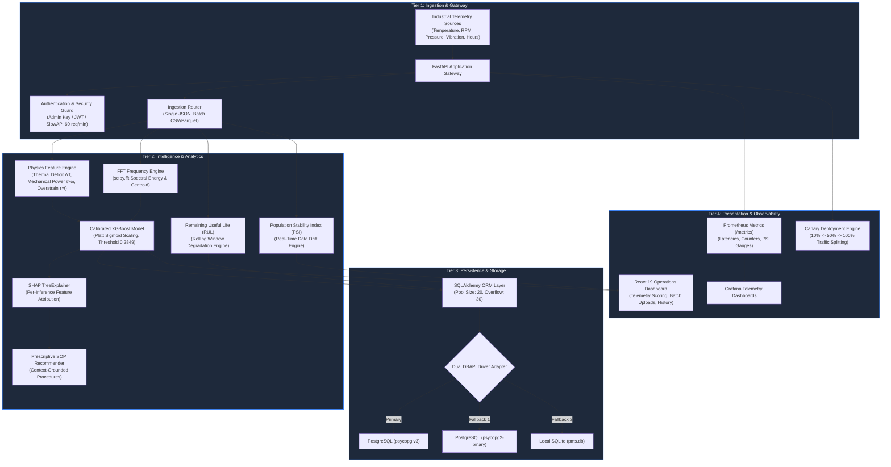

# Predictive Maintenance System (PMS) — System Architecture

This document provides a comprehensive technical reference for the architecture, subsystems, physical formulations, and operational data pipelines of the Predictive Maintenance System (`PMS`).

---

## 🏗️ 4-Tier System Architecture Diagram



---

## 1. Tier 1: Ingestion & Gateway Layer

The gateway serves as the single point of entry for industrial sensor streaming and batch telemetry analysis:

- **FastAPI / ASGI Framework**: Built on Python 3.12+ and Uvicorn with dual-worker multi-processing (`--workers 2`), handling high-concurrency sensor streaming with sub-millisecond route dispatching.
- **SlowAPI Token-Bucket Rate Limiter**: Enforces an IP-level rate limit of **60 requests/minute** on the high-frequency inference endpoint (`POST /predict`), insulating downstream ML and database workers against denial-of-service traffic.
- **Enterprise Authentication Guard**:
  - Mutual support for `X-API-Key` administrative headers and bcrypt-hashed signed JSON Web Tokens (`Authorization: Bearer <token>`).
  - Mutating and administrative endpoints (`POST /retrain`, `POST /batch-predict`, `POST /drift-status/reset`, `DELETE /history`) require admin privileges.
- **Batch Telemetry Ingestion Pipeline**:
  - Multi-format parser supporting CSV, JSON, XLSX, and Parquet uploads with streaming file validation.
  - Enforces strict security boundaries (maximum 5 MB upload ceiling, 5,000 maximum row limit).

---

## 2. Tier 2: Intelligence & Analytics Layer

### A. Physics-Informed Feature Engineering

Raw telemetry channels (temperature, RPM, pressure, vibration) are non-linearly coupled. PMS extracts domain-engineered interaction features reflecting thermodynamic and kinematic principles:

| Engineered Feature | Mathematical Formulation | Physical Degradation Mechanism |
| :--- | :--- | :--- |
| **Thermal Deficit ($\Delta T$)** | `temp_diff = T_process - T_air` | Heat dissipation failure across cooling jackets and lubricant degradation |
| **Mechanical Power ($P$)** | `power_w = (torque * 2 * π * rpm) / 60` | Electrical-to-mechanical conversion overload breaching motor winding envelope |
| **Overstrain Indicator ($OS$)** | `overstrain = torque * tool_wear_min` | Dynamic mechanical shearing and excessive cutting blade load |
| **Harmonic Pressure Ratio** | `ratio = pressure / (vibration + ε)` | Hydraulic cavitation, seal degradation, and fluid turbulence instability |
| **Dynamic Rotor Stress** | `rotor_stress = f(rpm, vibration)` | Bearing race spalling, centrifugal eccentricity, and unbalanced rotor mass |

### B. Fast Fourier Transform (FFT) Spectral Extraction

For high-frequency vibration waveforms, PMS utilizes `scipy.fft.rfft` to extract frequency-domain features:
- `vib_dominant_freq`: Principal vibration frequency mode identifying unbalance vs. gear mesh harmonics.
- `vib_spectral_energy_low`: Integrated spectral power in the 10–100 Hz band (structural looseness and misalignment).
- `vib_spectral_energy_high`: Integrated spectral power in the 300–1,000 Hz band (bearing roller defects and gear tooth impacts).
- `vib_spectral_centroid`: Center of mass of the frequency spectrum tracking broadband degradation.

### C. Calibrated XGBoost Risk Classifier

- **Platt Sigmoid Calibration**: Uses 3-fold cross-validated `CalibratedClassifierCV` wrapping regularized `XGBClassifier` to map raw decision margins into true empirical probabilities.
- **Brier Score Validation**: Achieves **0.0263** calibrated Brier score on the held-out test set (70.38% error reduction vs. 0.0887 uncalibrated).
- **PR-Curve Decision Threshold (`0.2849`)**: Counteracts severe 28:1 class imbalance, achieving **0.4277 F1-score** (0.3736 precision, 0.5000 recall).
- **Ambiguity Guard**: Predictions with probabilities in `[0.40, 0.60]` are marked `confidence: LOW` (`⚠️ UNCERTAIN`) to flag borderline events for technician inspection.

### D. Explainable AI & Prescriptive SOP Guidance

- **SHAP TreeExplainer**: Computes exact Shapley feature attributions per inference in under 5 ms, attributing elevated risk directly to physical sensors.
- **RAG / SOP Knowledge Base**: Context-grounded maintenance procedures pair top contributing risk factors with concrete, step-by-step Standard Operating Procedures (SOPs).

### E. Remaining Useful Life (RUL) Engine

- **Rolling-Window Multi-Feature Regression**: Computes 20-cycle rolling means, standard deviations, and degradation slopes across sensor channels.
- **Non-Linear Acceleration**: Predicts remaining operational cycles and estimated hours to critical threshold using serialized models (`ml/rul_model.pkl`).

### F. Population Stability Index (PSI) Drift Monitor

- Evaluates real-time distribution drift by comparing inference batches against training baselines across 10 empirical quantiles.
- Thresholds: `PSI < 0.10` (Stable), `0.10 <= PSI < 0.25` (Moderate Warning), `PSI >= 0.25` (Significant Drift Triggering Retraining).

---

## 3. Tier 3: Persistence & Storage Layer

- **SQLAlchemy 2.0 ORM**: Manages database schemas, connection pooling, and transaction rollbacks.
- **Resilient Connection Pooling**: Configured with `pool_size=20` and `max_overflow=30`, supporting bursty factory IoT workloads without connection pool starvation.
- **Dynamic Dual DBAPI Driver Fallback**:
  - Automatically tests driver availability at startup: checks modern `psycopg` (v3), falls back to legacy `psycopg2-binary`, and gracefully defaults to local SQLite (`pms.db`) for zero-configuration testing.
- **Alembic Schema Migrations**: Version-controlled database schema evolution supporting production PostgreSQL upgrades.

---

## 4. Tier 4: Presentation & Observability Layer

- **React 19 Web Dashboard**: High-contrast, responsive user interface featuring:
  - Real-time telemetry scoring with instant risk gauge visualization.
  - Multi-file batch prediction with CSV audit export.
  - Interactive PSI drift monitor and audit log browser.
- **Prometheus Instrumentation (`/metrics`)**:
  - Real-time request rate counters and HTTP status gauges.
  - Latency histograms (`p50`, `p95`, `p99`) across inference pipelines.
  - Model drift PSI gauges and inference risk counters.
- **Automated Canary Deployment Controller**:
  - Zero-downtime candidate model verification with phased traffic splits (10% -> 50% -> 100%).
  - Error budget and latency rollback guards.

---

## 5. Next-Gen Enterprise Capabilities (Boardroom Architecture)

As specified in [`docs/BOARDROOM_STRATEGY_AND_AUDIT.md`](BOARDROOM_STRATEGY_AND_AUDIT.md), PMS is evolving to support enterprise multi-plant operations:

### A. Prescriptive "What-If" Digital Twin Simulator
- Allows plant supervisors to simulate mechanical de-rating in real time (e.g., -15% Spindle RPM, +10% Coolant Pressure).
- Dynamically recalculates failure probability drop ($\Delta P$) and Remaining Useful Life (RUL) extension, enabling machinery to survive critical shifts without catastrophic failure.

### B. Real-Time Downtime Value-at-Risk ($VaR) Engine
- Couples calibrated failure probabilities with industrial downtime metrics ($C_{\text{downtime}} = \$12,500/\text{hr}$).
- Computes Financial Value at Risk ($VaR) and cumulative avoided capital losses to justify reliability investments to executive leadership.

### C. Industrial OT Protocol Gateway & Edge ONNX Runtime
- Ingests telemetry via asynchronous MQTT / OPC-UA bridges from shop-floor PLC networks.
- Supports standalone, sub-3ms edge inference via serialized ONNX runtime (`ml/model.onnx`), providing offline autonomy when cloud connectivity is unavailable.

### D. Closed-Loop CMMS/ERP Integration (SAP PM / IBM Maximo)
- Automatically compiles verified maintenance dispatch packages including equipment ID, plant bay coordinates, required Bill of Materials (BOM) part numbers (e.g., SKF bearing part numbers), and technician safety checklists.

### E. Cryptographic Model Manifest Verification
- Replaces static checksum constants with dynamically generated, cryptographically signed model manifests (`model_manifest.json.sig`), eliminating retraining crash vulnerabilities and securing the AI supply chain.

---

## 6. Context Engineering Architecture

### A. Motivation & Industrial Problem Statement
Raw telemetry frames (`temperature`, `rpm`, `pressure`, `vibration`, `operating_hours`) are context-blind. A temperature reading of 90°C during an idle run-up is a severe thermal anomaly, whereas the same reading under peak heavy milling in a 35°C ambient plant bay is nominal. Context Engineering bridges physical operational state with AI reasoning:

1. **Operational Regime Normalization**:
   - Categorizes telemetry by machine state: `idle`, `warmup`, `steady_state_light`, `steady_state_heavy`, `shutdown`.
   - Computes thermal deficit against ambient floor sensors: $\Delta T = T_{\text{process}} - T_{\text{ambient}}$.
2. **Temporal Momentum Gradients**:
   - Ingests first-order thermal gradient ($dT/dt$ in °C/min) to distinguish acute cooling failure from thermal equilibrium.
   - Computes vibration crest factors ($\text{Peak}/\text{RMS}$) to capture transient impact spalling.
3. **Structured Context Grounding**:
   - Synthesizes machine ID, equipment class, 24h prior alert history, and counterfactual intervention targets (`find_minimal_fix`) into the prompt payload before RAG SOP assembly.

---

## 7. High-Performance Multi-Runtime Inferencing (`backend/inference_engine.py`)

### A. Architectural Motivation
Industrial IoT streams generate telemetry at 100 Hz to 1 kHz per machine. Standard Python/Scikit-Learn/XGBoost inference incurs ~1.9 ms latency and GIL contention. PMS introduces a multi-runtime dispatcher:

```
[Inference Request]
        │
        ├──► ONNX Runtime (C++) ──► 0.021 ms / prediction (90.4x faster | ~47,600 req/sec)
        │
        ├──► Calibrated XGBoost ──► 1.909 ms / prediction (Platt Scaling + SHAP TreeExplainer)
        │
        └──► Hybrid Dispatcher  ──► Triage filter via ONNX; executes SHAP only when risk is elevated
```

### B. Empirical Benchmark Results
- **ONNX Runtime (C++ Execution Provider)**: **0.021 ms** (21 µs) mean latency; throughput: **~47,600 req/sec** per CPU core.
- **Calibrated XGBoost (Python)**: **1.909 ms** mean latency; throughput: **~520 req/sec**.
- **Speedup Factor**: **90.4x faster**.
- **Execution Routing**: Configurable via `runtime` parameter (`POST /predict?runtime=onnx|xgboost|hybrid`) or `X-Inference-Runtime` header.

---

## 8. Harness Engineering Suite (`harness/`)

### A. Architectural Purpose
Physical industrial machinery cannot be deliberately destroyed to test software pipelines. The Harness Engineering Suite provides automated, zero-hardware verification across three specialized harnesses:

1. **Scenario & Degradation Generator (`harness/scenarios/`)**:
   - Models physical failure trajectories:
     - **Thermal Runaway (HDF)**: Coolant pump blockage, exponential heat rise ($T > 95^\circ\text{C}$).
     - **Overstrain (OSF)**: Workpiece inclusion, hydraulic pressure spike ($P > 38\text{ bar}$).
     - **Tool Wear (TWF)**: Flank wear degradation ($H > 4800\text{h}$, $V > 0.65\text{g}$).
     - **Sensor Glitches**: Transducer EMI spikes and brownout recovery.
   - *Outcome*: 100% of physical failure modes detected across 125 total steps with zero false alarms.
2. **AI & RAG Evaluation Harness (`harness/eval/`)**:
   - Evaluates LLM narration groundedness ($G_{\text{score}}$: 80%–100%), citation recall, and prompt-injection defense against a 5-case golden incident benchmark.
   - Asserts zero honeytoken leakage from `CanaryTrap`.
3. **Chaos & Resilience Harness (`harness/chaos/`)**:
   - **Circuit Breaker FSM**: Injects synthetic LLM outages; verifies `CLOSED -> OPEN -> HALF_OPEN -> CLOSED` transitions with **3.6 µs fast-rejection latency**.
   - **Database Connection Severing**: Verifies that database commit crashes are rolled back safely and return HTTP 200 without gateway downtime.

---

## 9. Model Context Protocol (MCP) Server (`backend/mcp_server.py`)

PMS implements the open **Model Context Protocol (MCP)** specification (JSON-RPC 2.0), exposing PMS primitives to external AI agents (Antigravity, Claude Desktop, Cursor):

- **Transports**: Standard I/O (`python -m backend.mcp_server`) and HTTP gateway (`POST /mcp`).
- **MCP Tools**:
  - `predict_equipment_risk`: Runs failure prediction with runtime selection (`onnx`, `xgboost`, `hybrid`).
  - `predict_and_narrate`: Context-grounded RAG narration with auditable SOP chunks.
  - `simulate_derate_intervention`: Prescribes mechanical de-rating to lower failure probability and extend RUL.
  - `dispatch_work_order`: Automatically generates an ISO-compliant work order with BOM spare parts and safety interlocks.
  - `get_drift_telemetry`: Checks Population Stability Index (PSI) drift metrics.
  - `run_inference_benchmark`: Benchmarks C++ ONNX vs Python XGBoost.
- **MCP Resources**:
  - `pms://system/health`: System health and model status.
  - `pms://models/manifest`: Trained model metrics, hyperparameters, and ROC-AUC.
  - `pms://knowledge_base/sop_index`: RAG knowledge base document catalog.
- **MCP Prompts**:
  - `diagnose_machine_anomaly`: Guided step-by-step diagnostic workflow for technicians.
  - `shift_handover_report`: Plant manager reliability summary.

