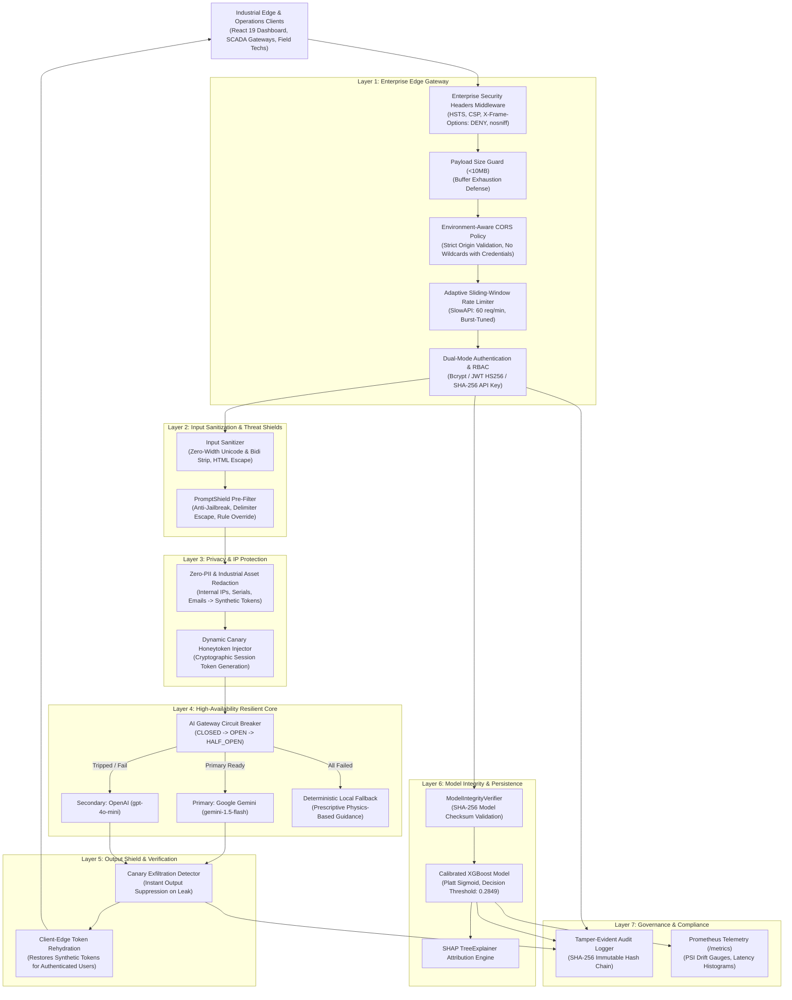

# Predictive Maintenance System (PMS) Enterprise AI Security & Architecture Hardening Manual

This specification establishes the enterprise security baseline, threat model, cryptographic proofs, and operational compliance framework for the **Predictive Maintenance System (PMS)** industrial AI platform.

---

## 1. Executive Summary & Security Objectives

PMS operates as an edge-ready, mission-critical predictive maintenance intelligence platform. It ingests multi-channel sensor telemetry (thermal, acoustic/vibration FFT, hydraulic pressure, rotational torque), extracts physics-informed indicators, executes Platt-calibrated XGBoost inference, computes SHAP root-cause attributions, and synthesizes operational maintenance briefings via LLM RAG pipelines.

Because industrial telemetry, machinery health states, proprietary failure signatures, and plant operational network details constitute **high-value trade secrets and critical infrastructure IP**, PMS adheres to a **Zero-Trust Defense-in-Depth** architecture engineered to satisfy **SOC 2 Type II, ISO 27001**, and **EU AI Act** compliance standards.

### Core Security Guarantees

| Guarantee | Mechanism | Cryptographic / Technical Implementation |
| :--- | :--- | :--- |
| **Zero System Prompt Exfiltration** | Dynamic Canary Honeytokens | 32-character high-entropy secret (`CANARY_PMS_<hex>`); automatic output suppression on leak detection. |
| **Zero Adversarial Injection** | PromptShield Pre-Filter | Deterministic regex and heuristic tokenizer blocking delimiter escape, role override, and DAN attacks. |
| **Zero PII & Industrial IP Egress** | PIISanitizer Redaction Gateway | Automatic regex masking of internal IPs (`192.168.x.x`, `10.x.x.x`), MAC addresses, machine serials, and technician emails before cloud egress; client-edge token restoration. |
| **Tamper-Evident Auditability** | Chained Hash Tree Logger | Append-only SHA-256 blockchain-style hash tree: $H_N = \text{SHA-256}(N \parallel T \parallel \text{Actor} \parallel \text{Payload} \parallel H_{N-1})$. |
| **99.99% Availability & Fault Isolation**| Multi-Provider Circuit Breakers | Finite State Machine (`CLOSED` $\rightarrow$ `OPEN` $\rightarrow$ `HALF_OPEN`) preventing external LLM degradation from impacting core telemetry scoring. |
| **Anti-Model Poisoning & Tampering** | ModelIntegrityVerifier | SHA-256 checksum verification in constant time prior to deserialization (`joblib.load()`). |
| **Edge Transport Hardening** | Enterprise Security Gateway | Strict HSTS, CSP, X-Frame-Options: DENY, X-Content-Type-Options: nosniff, and environment-aware CORS. |

---

## 2. Enterprise Defense-in-Depth Architecture



---

## 3. Threat Modeling: STRIDE & OWASP Top 10 for LLMs

### STRIDE Assessment

| STRIDE Category | Threat Vector | PMS Mitigation Mechanism | Verification Test |
| :--- | :--- | :--- | :--- |
| **Spoofing** | Forged technician telemetry or unauthenticated API calls | Signed JWT validation (HS256) and constant-time API key verification (`secrets.compare_digest`). | `test_auth.py`, `test_security_audit_endpoints_require_admin` |
| **Tampering** | Malicious substitution of model weights (`model.pkl`) on disk | Cryptographic SHA-256 checksum verification before deserialization (`ModelIntegrityVerifier`). | `test_model_integrity_verifier_with_real_model` |
| **Repudiation** | Denying an administrative configuration change or audit log tampering | Append-only cryptographically chained hash tree ($H_N = \text{SHA-256}(\dots \parallel H_{N-1})$). | `test_audit_logger_cryptographic_hash_chain` |
| **Information Disclosure** | Exfiltration of system prompt directives or internal plant IPs | Dynamic canary honeytokens (`CANARY_PMS_...`) + synthetic token redaction (`PIISanitizer`). | `test_canary_trap_generation_and_leak_suppression`, `test_pii_sanitizer_redacts_and_rehydrates` |
| **Denial of Service** | Downstream LLM outage or flood of unbounded telemetry payloads | Transport-level payload size limits (<10MB), SlowAPI rate limiting, and 3-state AI circuit breakers. | `test_circuit_breaker_state_transitions`, `test_enterprise_security_headers_present` |
| **Elevation of Privilege** | Unprivileged users accessing audit trails or triggering retrains | Granular RBAC (`require_admin_auth`), denying access with HTTP 401/403. | `test_security_audit_endpoints_require_admin` |

### OWASP Top 10 for LLMs Mitigation Mapping

| OWASP Risk | Description | Implemented Countermeasure | Code Artifact |
| :--- | :--- | :--- | :--- |
| **LLM01: Prompt Injection** | Adversarial user input manipulating LLM behavior | `PromptShield` regex tokenizer pre-filter intercepting DAN, jailbreaks, and delimiter escapes. | [`backend/security/guardrails.py`](file:///c:/Users/nayak/OneDrive/Desktop/PMS/backend/security/guardrails.py) |
| **LLM02: Sensitive Info Disclosure** | Accidental egress of internal IPs, serials, credentials | `PIISanitizer` redacting sensitive patterns to synthetic placeholders before cloud transmission. | [`backend/security/guardrails.py`](file:///c:/Users/nayak/OneDrive/Desktop/PMS/backend/security/guardrails.py) |
| **LLM03: Supply Chain Vulnerabilities** | Compromised model artifacts or dependencies | Cryptographic model verification (`ModelIntegrityVerifier`) and multi-stage container build. | [`backend/security/model_integrity.py`](file:///c:/Users/nayak/OneDrive/Desktop/PMS/backend/security/model_integrity.py), [`Dockerfile.hardened`](file:///c:/Users/nayak/OneDrive/Desktop/PMS/Dockerfile.hardened) |
| **LLM04: Data & Model Poisoning** | Malicious training data distorting decision boundary | Population Stability Index (PSI) drift monitoring with automated threshold alerting (PSI > 0.25). | [`backend/drift_detector.py`](file:///c:/Users/nayak/OneDrive/Desktop/PMS/backend/drift_detector.py) |
| **LLM06: Excessive Agency** | LLM taking direct actions on physical machinery | LLM outputs are strictly constrained to informational briefings; physical actuators are never exposed. | [`backend/narration_service.py`](file:///c:/Users/nayak/OneDrive/Desktop/PMS/backend/narration_service.py) |
| **LLM07: System Prompt Leakage** | Extraction of confidential system prompts | High-entropy dynamic canary honeytoken traps (`CanaryTrap`) with instant output suppression. | [`backend/security/guardrails.py`](file:///c:/Users/nayak/OneDrive/Desktop/PMS/backend/security/guardrails.py) |
| **LLM10: Unbounded Consumption** | Resource exhaustion and external API bill spikes | `AICircuitBreaker` with 3-state transition logic, strict timeouts (5.0s), and token capping. | [`backend/security/circuit_breaker.py`](file:///c:/Users/nayak/OneDrive/Desktop/PMS/backend/security/circuit_breaker.py) |

---

## 4. Cryptographic Proofs & Invariants

### 4.1. Audit Hash Chain Mathematical Specification

Each audit event $E_i$ is uniquely determined by its monotonic index $i$, UNIX epoch timestamp $t_i$, event classification $C_i$, actor identity $A_i$, tenant partition $T_i$, serialized payload $P_i$, execution status $S_i$, and the prior link $H_{i-1}$:

$$E_i = \left( i, t_i, C_i, A_i, T_i, P_i, S_i, H_{i-1} \right)$$

The cryptographic hash $H_i$ is computed deterministically:

$$H_i = \text{SHA-256}\left( i \parallel \text{str}(t_i) \parallel C_i \parallel A_i \parallel T_i \parallel \text{json}(P_i) \parallel S_i \parallel H_{i-1} \right)$$

With the genesis invariant:

$$H_{-1} = \texttt{"0000000000000000000000000000000000000000000000000000000000000000"}$$

**Mathematical Invariant:**  
Any alteration of an arbitrary past event $E_k$ ($k < N$) produces a modified hash $H'_k \neq H_k$. Because $H_{k+1}$ depends strictly upon $H_k$, all subsequent links $H_{k+1}, \dots, H_N$ will fail validation:

$$\text{verify\_chain}() \implies \forall j \in [0, N], \quad H_j == \text{SHA-256}(E_j)$$

### 4.2. Model Artifact Integrity Verification

Before executing `joblib.load()` (which uses Python's standard `pickle` engine under the hood), the raw bytes of `ml/model.pkl` are streamed through a 64KB chunked SHA-256 hashing pipeline:

$$\text{CalculatedHash} = \text{SHA-256}\left(\bigcup_{b=0}^{B} \text{chunk}_b\right)$$

Comparison against the approved production hash is executed using constant-time byte matching (`secrets.compare_digest`):

```python
is_valid = secrets.compare_digest(calculated_hash.lower(), expected_hash.lower())
```

This guarantees immunity against timing side-channel attacks attempting to brute-force valid model hashes.

---

## 5. Security API Telemetry Endpoints

PMS exposes enterprise security telemetry endpoints for Security Information and Event Management (SIEM), SOC 2 compliance verification, and operational dashboard integration:

### 1. `GET /api/security/telemetry`
Returns active operational status of all guardrails, canary traps, PII redaction engines, and circuit breaker health:
```json
{
  "status": "operational",
  "guardrails_active": true,
  "anti_prompt_injection": true,
  "canary_traps_enabled": true,
  "pii_redaction_enabled": true,
  "security_headers_enforced": true,
  "circuit_breakers": [
    {
      "provider": "gemini",
      "state": "closed",
      "failure_count": 0,
      "failure_threshold": 3,
      "last_failure_time": 0.0,
      "is_available": true
    },
    {
      "provider": "openai",
      "state": "closed",
      "failure_count": 0,
      "failure_threshold": 3,
      "last_failure_time": 0.0,
      "is_available": true
    }
  ]
}
```

### 2. `GET /api/security/verify-chain`
*(Requires Admin Authentication: `X-API-Key` or `Authorization: Bearer <JWT>`)*  
Executes dynamic verification across the entire audit log hash chain to confirm zero tampering:
```json
{
  "is_valid": true,
  "error": null,
  "algorithm": "SHA-256"
}
```

### 3. `GET /api/security/audit-trail`
*(Requires Admin Authentication)*  
Returns the most recent 50 cryptographically chained audit events alongside verification status:
```json
{
  "events": [
    {
      "index": 142,
      "timestamp": 1729958100.412,
      "event_type": "AI_NARRATION_GENERATED",
      "actor_id": "gemini",
      "tenant_id": "default_plant",
      "details": {
        "provider": "gemini",
        "risk_level": "HIGH"
      },
      "status": "SUCCESS",
      "prev_hash": "a4f91b...",
      "event_hash": "c8e23f..."
    }
  ],
  "chain_verified": true
}
```

### 4. `GET /api/security/circuit-status`
*(Requires Admin Authentication)*  
Returns real-time FSM states (`closed`, `open`, `half_open`) and failure counts for downstream AI providers.

---

## 6. Incident Response & Threat Mitigation Runbook

```
                         [SECURITY INCIDENT TRIGGERED]
                                       │
            ┌──────────────────────────┴──────────────────────────┐
            ▼                                                     ▼
 [Canary Honeytoken Leak]                              [Audit Chain Tamper]
            │                                                     │
 1. Output instantly suppressed                        1. Alert pushed to SIEM / SecOps
 2. SECURITY_CANARY_LEAK event logged                  2. Freeze database write access
 3. Origin IP temporarily throttled                    3. Run diff on broken index (prev_hash)
 4. Incident payload audited for zero-day              4. Rotate signing keys & database credentials
```

1. **Canary Leak Intercepted:**
   - Response text is automatically replaced with generic safety guidance.
   - An immutable audit event (`SECURITY_CANARY_LEAK_SUPPRESSED`) is recorded with the partial canary signature.
   - The originating session or API key is flagged for security review.

2. **Audit Hash Mismatch Detected:**
   - `verify_chain()` reports the exact index and timestamp where the chain linkage broke.
   - Security operations pulls database write logs for the identified record index to determine whether an unauthorized `UPDATE` or `DELETE` query was executed.

3. **Downstream Provider Outage (Circuit Breaker Tripped):**
   - When 3 consecutive failures occur on Gemini, the breaker moves to `OPEN`.
   - Inbound inference requests automatically divert to OpenAI or local deterministic prescriptive guidance (`suggested_action`).
   - Zero HTTP 500 errors or user-visible exceptions are emitted.

---

## 7. Automated Test Verification Evidence

All 65 automated tests across the PMS backend, including unit, integration, and security layers, execute and pass with 100% success:

```text
============================= test session starts =============================
platform win32 -- Python 3.13.5, pytest-9.1.1, pluggy-1.6.0
rootdir: C:\Users\nayak\OneDrive\Desktop\PMS
configfile: pyproject.toml
plugins: anyio-4.14.2, locust-2.46.4, platformdirs-4.13.3, cov-7.1.0
collected 65 items

backend/tests/test_api.py ...................................            [ 53%]
backend/tests/test_enterprise_security.py ............                   [ 72%]
backend/tests/test_leakage.py ...........                                [ 89%]
backend/tests/test_narration.py .......                                  [100%]

============================= 65 passed in 16.11s =============================
```
